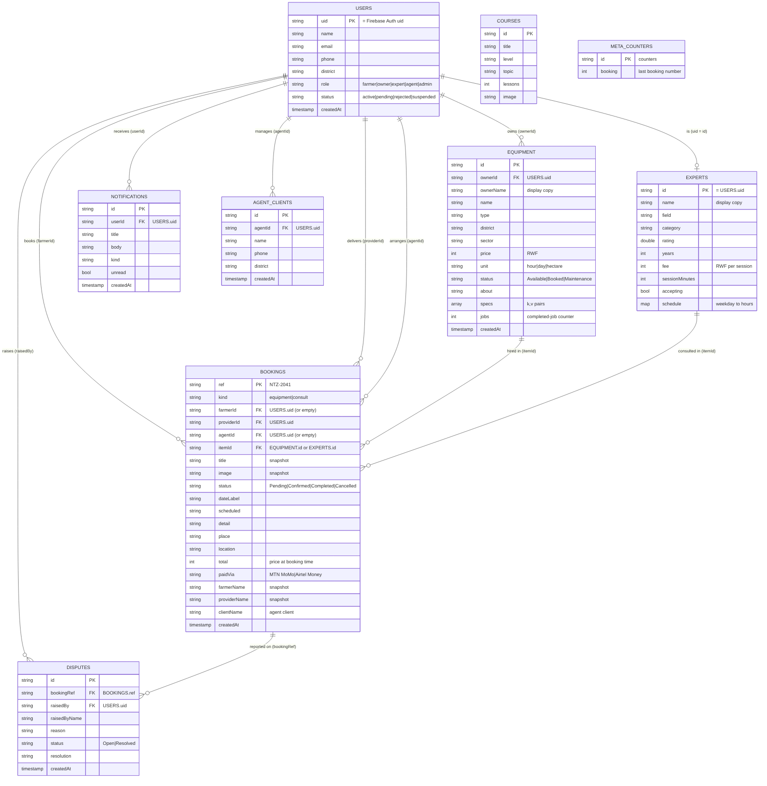

# Entity-Relationship Diagram

The diagram below is the **implemented** Cloud Firestore structure. Every field name is defined once in
`lib/data/mappers/firestore_mappers.dart`, and the security rules in `firestore.rules` refer to the same names.

(Source: [`erd.mmd`](erd.mmd) — Mermaid.)

## Collections

| Collection | Primary key | Foreign keys | Purpose |
|---|---|---|---|
| `users` | `uid` (= Firebase Auth uid) | – | Profile, role and approval status |
| `equipment` | `id` | `ownerId → users.uid` | Machines that can be hired |
| `experts` | `id` (= `users.uid`) | `id → users.uid` | Expert profile, fee and weekly availability |
| `courses` | `id` | – | Training courses |
| `bookings` | `ref` (`NTZ-2041`) | `farmerId`, `providerId`, `agentId → users.uid`; `itemId → equipment.id` or `experts.id` | Hire / consultation request |
| `notifications` | `id` | `userId → users.uid` | In-app alerts |
| `disputes` | `id` | `bookingRef → bookings.ref`, `raisedBy → users.uid` | Reported problems |
| `agentClients` | `id` | `agentId → users.uid` | Farmers an agent books for |
| `meta/counters` | `counters` | – | Last booking number (`NTZ-n`) |

## Design decisions

* **Relationships by id.** Firestore has no joins, so a foreign key is a document id held in a field
  (`ownerId`, `farmerId`, …). `bookings.itemId` points to either an equipment or an expert document, and
  `kind` says which.
* **Snapshots, not duplicates.** A booking stores `title`, `image`, `farmerName`, `providerName` and `total`
  as they were *when the booking was made* (like an order line on an invoice). Editing or deleting the
  equipment later must not change history. `equipment.ownerName` and `experts.name` are display copies that
  avoid one extra read per list row.
* **No derived data is stored.** The equipment photo is computed from `type`; earnings, commission and
  charts are computed from bookings. The only stored counter is `equipment.jobs`, incremented in the same
  operation that completes a booking.
* **Indexes.** Queries that filter by one participant and sort by `createdAt` use the composite indexes in
  `firestore.indexes.json` (`bookings`: `farmerId` / `providerId` / `agentId` + `createdAt`; `notifications`:
  `userId` + `createdAt`).
